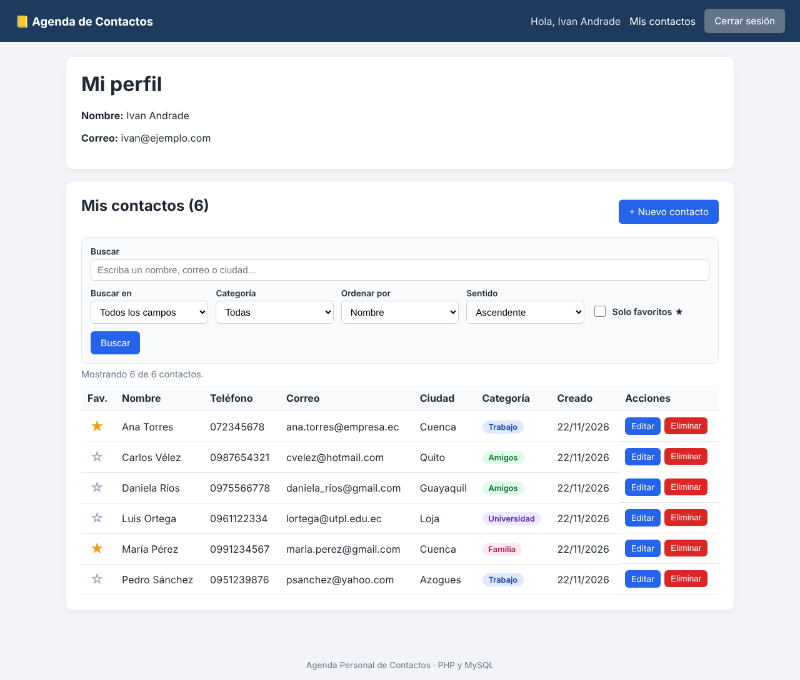
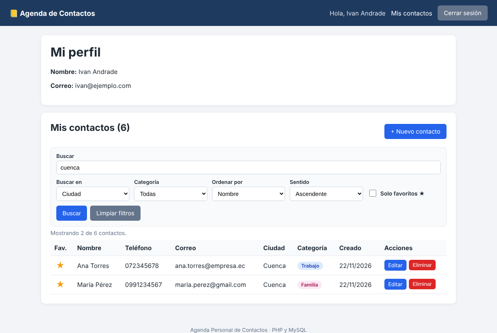
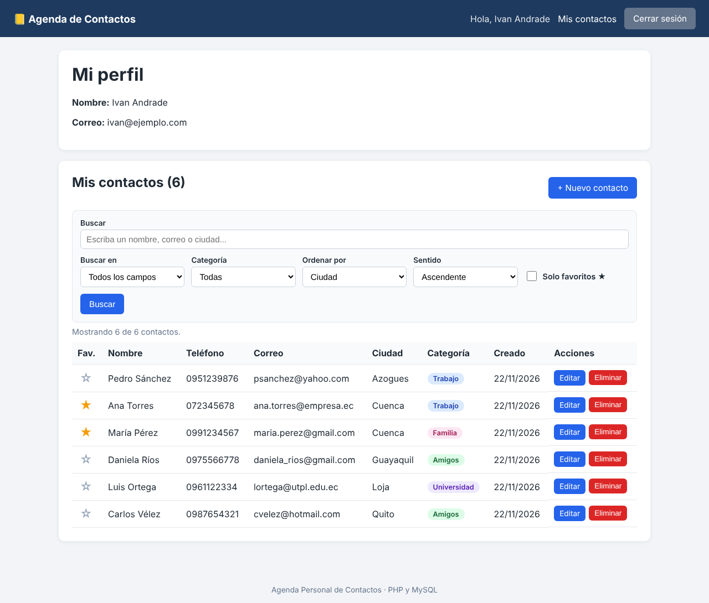
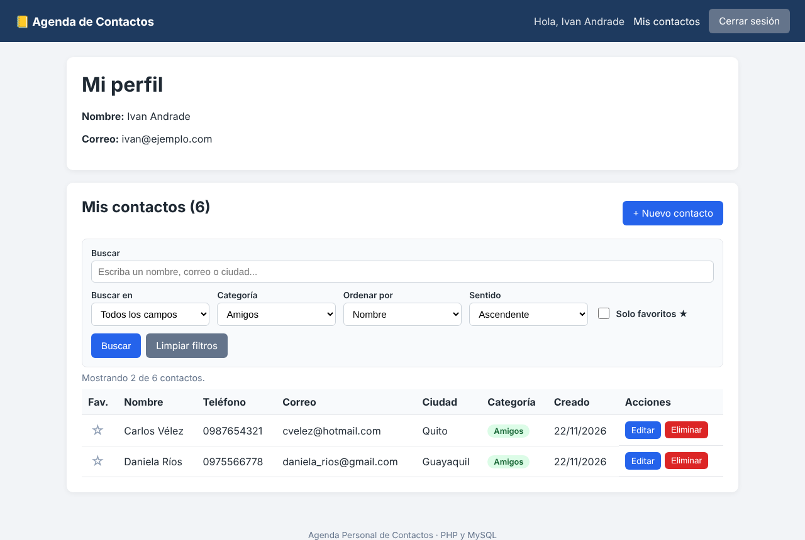
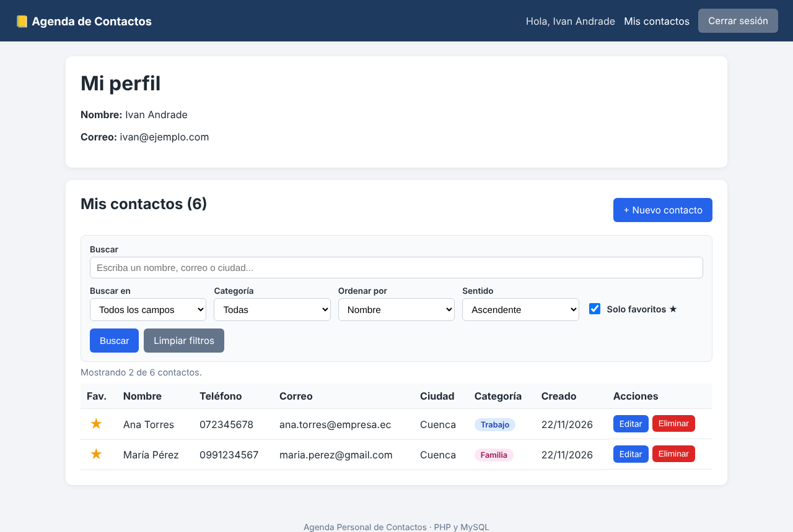
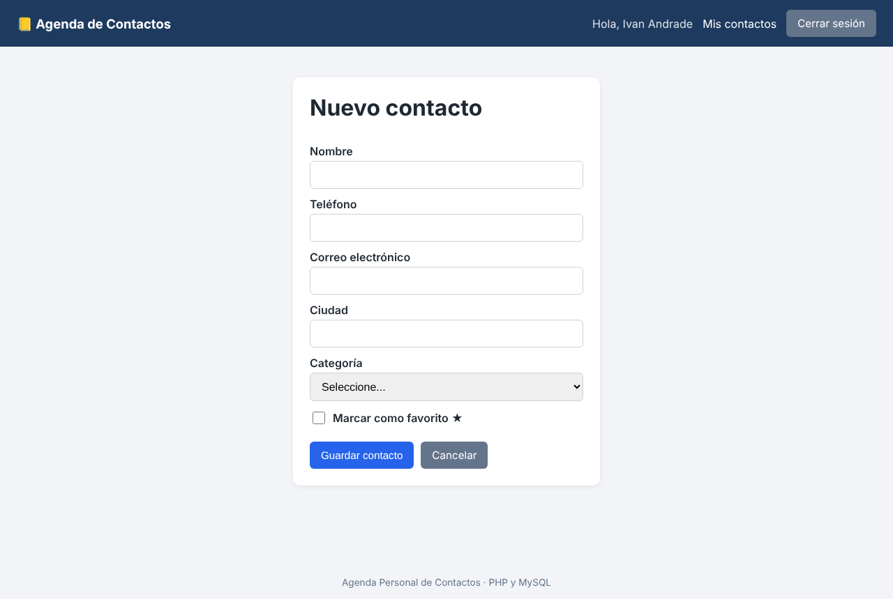

# Agenda Personal de Contactos con Autenticación en PHP (versión 2)

## URL pública

🔗 **https://CAMBIAR-POR-SU-URL.infinityfreeapp.com**

La aplicación está publicada en el hosting gratuito **InfinityFree**. Para probarla, cree una cuenta en "Regístrese aquí" e inicie sesión.

## Descripción del proyecto

Aplicación web desarrollada en PHP y MySQL que permite a los usuarios **registrarse**, **iniciar sesión** y administrar una **agenda personal de contactos** (crear, ver, editar y eliminar).

Cada usuario solo puede ver y gestionar **sus propios contactos**. Las páginas privadas verifican que exista una sesión activa, y todas las consultas a la tabla `contactos` filtran por el usuario de la sesión, por lo que no es posible acceder a contactos de otra persona cambiando el `id` en la URL.

En esta segunda versión se agregaron cuatro mejoras: búsqueda, ordenamiento, categorías y contactos favoritos.

## Mejoras respecto a la versión anterior

| Mejora | Versión 1 | Versión 2 |
|---|---|---|
| **A. Búsqueda de contactos** | Filtro solo en el navegador (JavaScript) sobre la tabla visible. | Búsqueda en el servidor con PHP y SQL. Se puede buscar en **nombre**, **correo**, **ciudad** o en todos los campos a la vez. Muestra "Mostrando X de Y contactos". |
| **B. Ordenamiento** | Siempre ordenado por nombre. | Ordenar por **nombre**, **ciudad** o **fecha de creación**, en sentido ascendente o descendente. |
| **C. Categorías** | No existían. | Nueva tabla `categorias` (Familia, Amigos, Trabajo, Universidad, Otro). Cada contacto pertenece a una categoría, que se elige al crear o editar y se puede usar como filtro. Se muestra como etiqueta de color. |
| **D. Contactos favoritos** | No existían. | Nuevo campo `favorito` (Sí/No). Se marca desde el formulario o con la estrella ★ de la tabla, y la casilla "Solo favoritos" muestra únicamente los favoritos. |

Otros cambios:

- Nuevo campo `fecha_creacion` en `contactos`, que se usa para ordenar y se muestra en la columna "Creado".
- Los filtros se pueden combinar (por ejemplo: favoritos de la categoría Trabajo que viven en Cuenca) y se mantienen después de marcar un favorito.
- Al cambiar la categoría, el orden o "Solo favoritos", la lista se actualiza sola gracias al evento `change` en JavaScript.
- Los datos de conexión del hosting se guardan en `config/credenciales.php`, que **no se sube a GitHub** (ver `.gitignore`), para no publicar la contraseña de la base de datos.

### Cómo se implementaron (resumen técnico)

- **Búsqueda:** `panel.php` arma la consulta con `LIKE` y sentencias preparadas. Los caracteres `%` y `_` que escriba el usuario se escapan (`escapar_like()` en `includes/funciones.php`) para que se busquen como texto normal.
- **Ordenamiento:** la columna de orden se toma de una lista cerrada en PHP (`$ordenes`). Nunca se pone en el SQL lo que escribe el usuario, así se evita la inyección SQL.
- **Categorías:** la categoría elegida se valida en el servidor contra las categorías que existen en la base de datos. La tabla `contactos` tiene una clave foránea hacia `categorias`.
- **Favoritos:** `contacto_favorito.php` cambia el valor con `UPDATE ... SET favorito = 1 - favorito`, solo por POST, con token CSRF y comprobando que el contacto sea del usuario de la sesión.

## Capturas de pantalla

**Panel con todos los contactos, categorías y favoritos**



**A. Búsqueda (ciudad = "cuenca")**



**B. Ordenamiento por ciudad**



**C. Filtro por categoría (Amigos)**



**D. Solo favoritos**



**Formulario de nuevo contacto con categoría y favorito**



## Seguridad implementada

| Requisito | Cómo se implementó |
|---|---|
| Contraseñas protegidas | `password_hash()` al registrar y `password_verify()` al iniciar sesión. Nunca se guarda la contraseña real. |
| Validación en el servidor | Todos los formularios se validan en PHP (campos obligatorios, formato de correo, teléfono, longitudes y categoría válida). |
| Sesión activa en páginas protegidas | La función `requerir_sesion()` se llama al inicio de cada página privada. |
| Acceso solo a contactos propios | Las consultas usan `WHERE id = ? AND id_usuario = ?` con el id del usuario guardado en la sesión. |
| Mensajes de error seguros | El login muestra "Correo o contraseña incorrectos" sin indicar cuál dato falló. Los errores de base de datos no se muestran al usuario. |
| Inyección SQL | Todas las consultas usan sentencias preparadas con PDO. El orden y el campo de búsqueda salen de listas cerradas. |
| XSS | Todo dato mostrado en pantalla pasa por `htmlspecialchars()`. |
| CSRF | Los formularios que modifican datos (crear, editar, eliminar, favorito) incluyen un token que se valida en el servidor. |
| Fijación de sesión | Se usa `session_regenerate_id(true)` al iniciar sesión. |
| Credenciales del hosting | Se guardan en `config/credenciales.php`, excluido del repositorio con `.gitignore`. |

## Programación orientada a eventos

El archivo `assets/js/app.js` responde a eventos del usuario:

- `submit`: pide confirmación antes de eliminar un contacto y valida los formularios antes de enviarlos.
- `input`: quita el mensaje de error mientras el usuario corrige un campo.
- `change` (nuevo): al cambiar la categoría, el orden o la casilla "Solo favoritos", envía el formulario de filtros y la lista se actualiza.

A diferencia de un programa de línea de comandos, que se ejecuta en orden de principio a fin, este código espera a que el usuario realice una acción y responde a ella.

## Tecnologías utilizadas

- PHP 8 (PDO)
- MySQL / MariaDB
- HTML5, CSS3 y JavaScript
- XAMPP (Apache + MySQL) como entorno local
- InfinityFree como hosting gratuito
- Git y GitHub para el control de versiones

## Instalación local

### Requisitos

- XAMPP (o cualquier servidor con Apache, PHP 8.0 o superior y MySQL/MariaDB).
- Extensión `pdo_mysql` habilitada (viene activa en XAMPP).
- Navegador web.

### Pasos

1. Descargar o clonar el repositorio:
   ```bash
   git clone https://github.com/Ivan9825/agenda-contactos.git
   ```
2. Copiar la carpeta `agenda-contactos` dentro de `C:\xampp\htdocs\`.
3. Abrir el panel de XAMPP e iniciar **Apache** y **MySQL**.
4. Entrar a `http://localhost/phpmyadmin`, ir a la pestaña **Importar** y cargar el archivo `database/agenda.sql`. Esto crea la base de datos `agenda_contactos` con las tablas `usuarios`, `categorias` y `contactos`.
   - Si ya tenía la base de datos de la versión 1 y quiere conservar sus datos, seleccione la base `agenda_contactos` e importe `database/actualizar_v1_a_v2.sql`.
5. Si su MySQL tiene usuario o contraseña distintos a los de XAMPP, copie `config/credenciales.ejemplo.php` como `config/credenciales.php` y ponga sus datos.
6. Abrir en el navegador: `http://localhost/agenda-contactos/`
7. Crear una cuenta en **Regístrese aquí** e iniciar sesión.

## Despliegue en InfinityFree

1. Crear una cuenta en [infinityfree.com](https://www.infinityfree.com) y una cuenta de hosting con un subdominio gratuito.
2. En el panel, ir a **MySQL Databases**, crear una base de datos y anotar el *hostname*, el nombre de la base, el usuario y la contraseña.
3. Abrir **phpMyAdmin** desde el panel, seleccionar la base de datos e importar `database/agenda_hosting.sql`.
4. Abrir el **File Manager**, entrar a la carpeta `htdocs` y subir todos los archivos del proyecto.
5. Dentro de `htdocs/config/`, crear el archivo `credenciales.php` (copia de `credenciales.ejemplo.php`) con los datos del paso 2.
6. Abrir la URL del subdominio y probar el registro, el inicio de sesión y las mejoras.

## Estructura del proyecto

```
agenda-contactos/
├── assets/
│   ├── css/estilos.css            # Estilos
│   └── js/app.js                  # Eventos del usuario (confirmación, validación, filtros)
├── config/
│   ├── db.php                     # Conexión PDO a MySQL
│   └── credenciales.ejemplo.php   # Plantilla de datos del hosting
├── database/
│   ├── agenda.sql                 # Script completo para instalación local
│   ├── agenda_hosting.sql         # Mismo script, sin CREATE DATABASE (para el hosting)
│   └── actualizar_v1_a_v2.sql     # Actualiza una base de datos de la versión 1
├── docs/capturas/                 # Capturas de pantalla
├── includes/
│   ├── funciones.php              # Sesión, seguridad, validaciones y categorías
│   ├── header.php / footer.php
│   └── form_contacto.php          # Formulario compartido (crear/editar)
├── index.php                      # Redirige a login o panel
├── registro.php                   # Registro de usuarios
├── login.php                      # Inicio de sesión
├── logout.php                     # Cierre de sesión
├── panel.php                      # Panel privado: lista, búsqueda, orden y filtros
├── contacto_nuevo.php             # Crear contacto
├── contacto_editar.php            # Editar contacto
├── contacto_eliminar.php          # Eliminar contacto
└── contacto_favorito.php          # Marcar o quitar favorito (nuevo)
```
